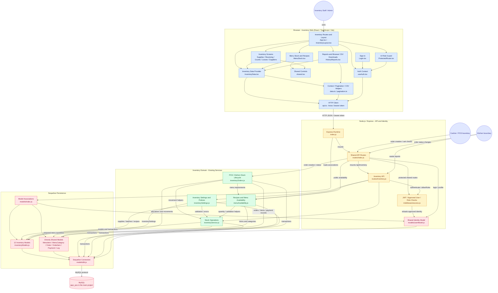

# JAPZ Inventory - Verified System Architecture

Verified from the new supplied GitDiagram architecture and the implemented Inventory source. Browser components, backend responsibilities, shared model dependencies and direct POS/Kitchen boundaries are corrected.

The initial GitDiagram Mermaid is preserved in `output/inventory-diagrams-reviewed/_work/original-INVENTORY_ARCHITECTURE.md`. The Word-ready figure and all 17 finalized diagrams are in `output/inventory-diagrams-reviewed`.
