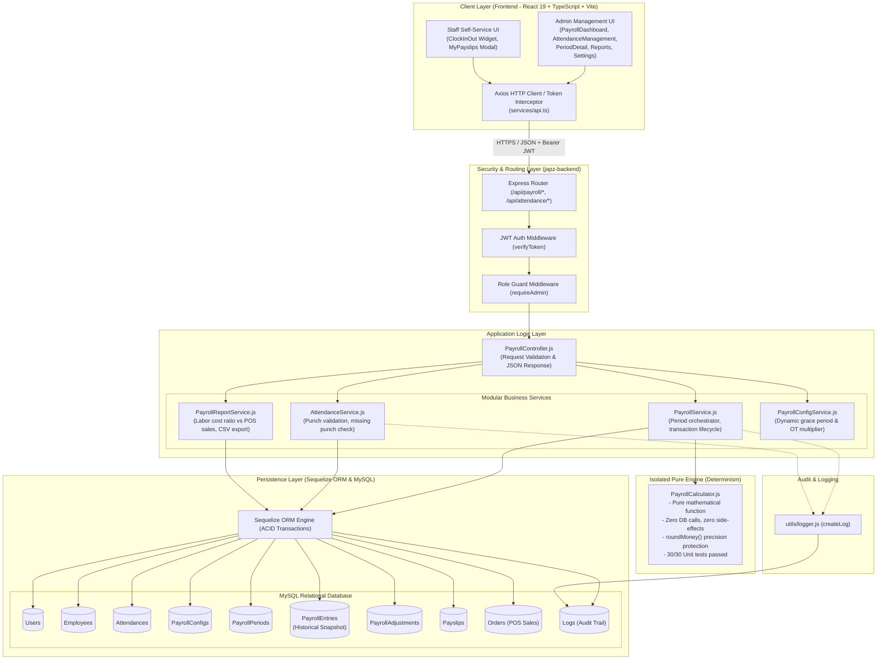
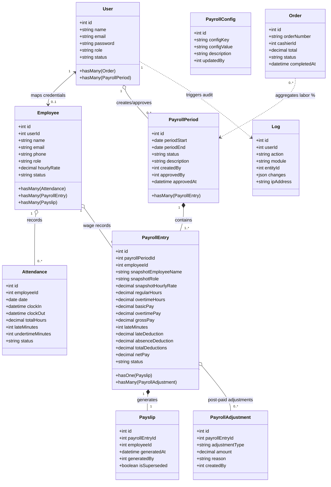
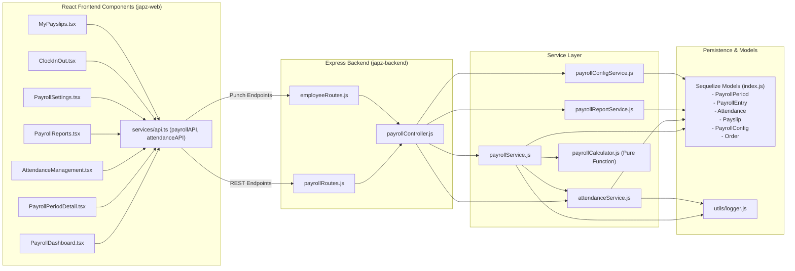
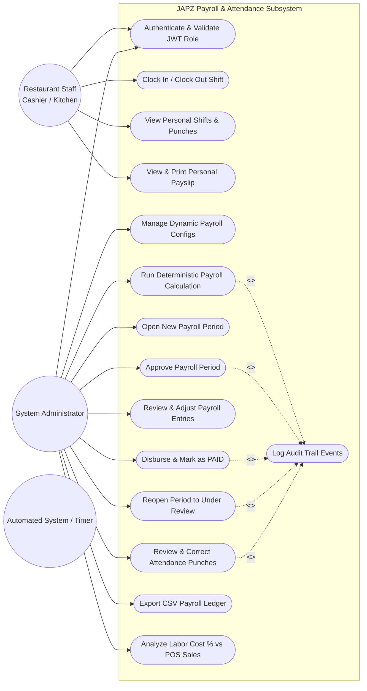
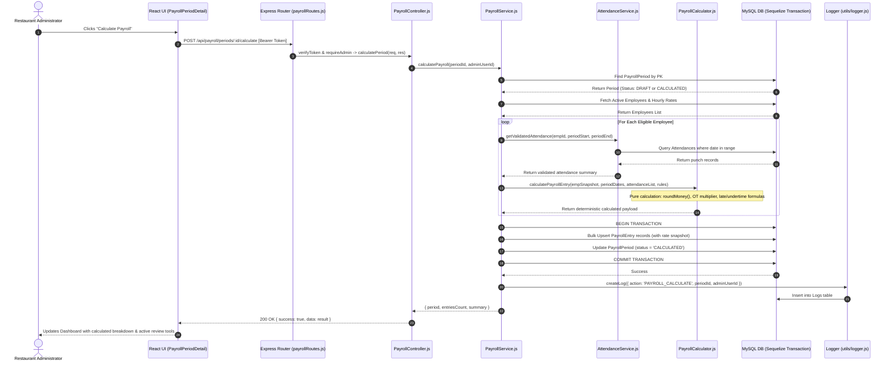
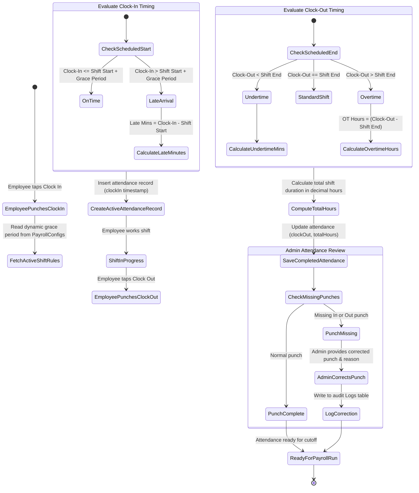
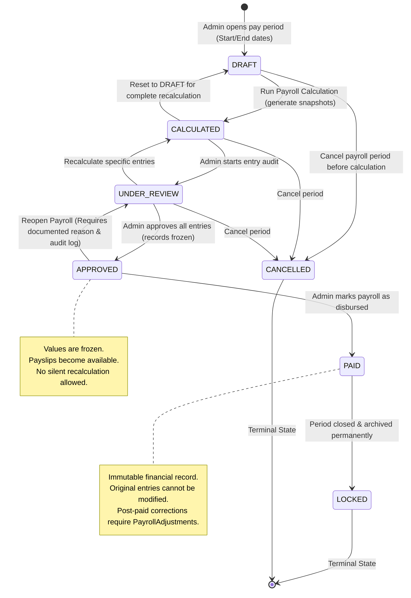
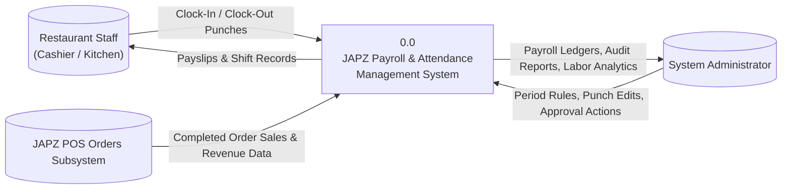
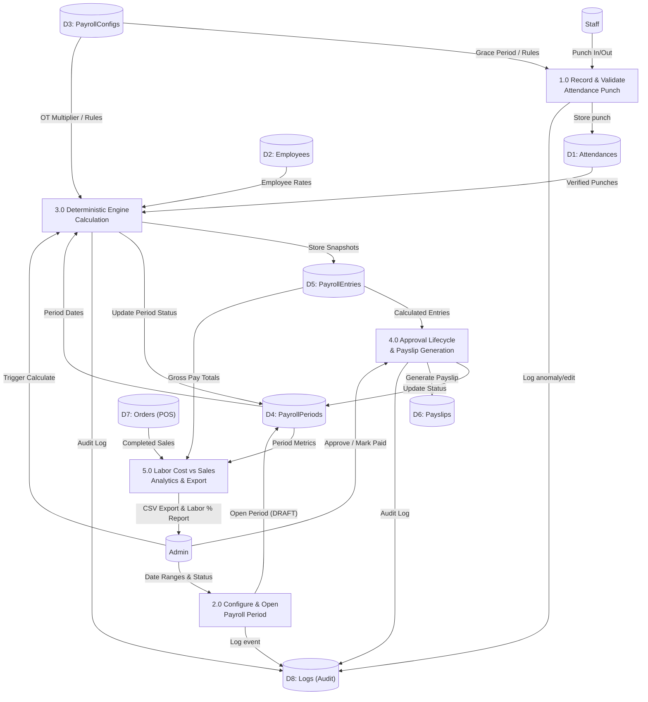

# JAPZ Payroll & Attendance Management System
## System Modeling & Architectural Blueprint Document

Based on the blueprinting framework defined in `diagrams.docx`, this document details the system identification, structural blueprinting, behavioral blueprinting, data flow blueprinting, and complete visual diagram models for the **JAPZ Payroll & Attendance Management System** (Subsystem of the JAPZ Mobile POS & Restaurant Management Platform).

---

## Part 1: Project Identification & Blueprinting Worksheet

### 1. Project Identification
- **Project / Proposal Title:**
  **JAPZ: Automated Payroll, Time & Attendance, and Labor Cost Analytics Module for Restaurant Management System**
- **System Summary (2–3 Sentences):**
  The JAPZ Payroll & Attendance Management System is a specialized operational module integrated into the JAPZ Mobile POS platform that automates staff time tracking, shift verification, and deterministic payroll generation for restaurant personnel (cashiers, kitchen staff, and managers). It enforces strict labor rules (dynamic grace periods, late/undertime deductions, and overtime calculations), snapshots historical wage data across an immutable 7-stage approval lifecycle (`DRAFT` → `PAID`), and provides real-time labor cost-to-sales ratios against completed POS transactions to optimize restaurant operating margins.

---

### 2. Structural Blueprinting

- **Selected Structural Diagram:**
  **System Architecture Diagram** *(supplemented by a detailed **Class / Entity-Relationship Diagram** and **Component Diagram**)*
- **Infrastructure & Layout Justification:**
  A **System Architecture Diagram** is critical because the payroll module operates across a multi-tier client-server environment where financial data integrity, role-based authorization, and calculation determinism are paramount:
  1. **Tier Separation:** It defines how the lightweight browser client (React 19, TypeScript, Vite) interacts with the Node.js/Express.js backend via authenticated JWT Bearer HTTP requests.
  2. **Layered Isolation (Separation of Concerns):** It explicitly documents the boundary between mutable API controllers/services and the isolated, pure-function `PayrollCalculator.js` engine (which has zero database dependencies to guarantee determinism).
  3. **Database & Storage Layer:** It maps how Sequelize ORM bridges business models (`PayrollPeriod`, `PayrollEntry`, `Attendance`, `PayrollConfig`, `Payslip`, `Logs`) to the underlying MySQL database with atomic ACID transactions and audit log tracking.

---

### 3. Behavioral Blueprinting

- **Selected Behavioral Diagram 1:**
  **Use Case Diagram**
  - **Project Scenario Mapped:**
    Maps out the core actors (**System Administrator**, **Cashier Employee**, and **Kitchen Staff**) and their interactions with the system. Cashiers and Kitchen staff interact with the **Clock-In/Clock-Out widget** and view personal payslips, while the System Administrator conducts **Attendance Verification & Correction**, sets **Dynamic Payroll Configurations** (grace periods, OT multipliers), initiates **Deterministic Payroll Period Calculation**, executes **Multi-State Approvals & Reopen Workflows**, and exports **Financial CSV / Labor Cost Analytics**.

- **Selected Behavioral Diagram 2:**
  **Sequence Diagram**
  - **Project Scenario Mapped:**
    Maps out the chronological execution and transactional API handshake of the **Payroll Period Calculation & Approval Lifecycle**:
    1. Admin triggers `POST /api/payroll/periods/:id/calculate`.
    2. `PayrollController` invokes `PayrollService.calculatePayroll()`.
    3. `PayrollService` retrieves eligible employees and validated attendance logs from `AttendanceService`.
    4. `PayrollService` feeds employee snapshots into the pure `PayrollCalculator` function.
    5. Calculated entries are saved inside a database transaction (`PayrollEntry` snapshot records).
    6. System records the audit trail via `createLog()` in the `Logs` table.
    7. Standardized JSON response returns to the UI to update the period state machine to `CALCULATED`.

*(Additional behavioral models provided: **State Machine Diagram** for the 7-status lifecycle and **Activity Diagram** for attendance shift validation).*

---

### 4. Data Blueprinting (Data Flow)

- **How Data Flows From User Input to System Database:**
  1. **Input Capture:** A restaurant worker clicks "Clock In" or "Clock Out" on their POS interface (`ClockInOut.tsx`), or an Administrator enters payroll parameters / triggers period calculation on `PayrollPeriodDetail.tsx`.
  2. **Client Validation & Transport:** The React frontend captures the payload, attaches the JWT Bearer authorization token, and transmits an HTTP POST/PUT request through Axios (`services/api.ts`).
  3. **Middleware & Route Ingestion:** Express receives the request at `/api/payroll/*` or `/api/attendance/*`. `verifyToken` validates the JWT signature, and `requireAdmin` validates operational clearance (for administrative payroll functions).
  4. **Service & Pure Calculation Processing:**
     - For attendance: `attendanceService.js` evaluates the current timestamp against the shift schedule and grace period, computes elapsed hours/minutes, and flags missing punches.
     - For payroll: `payrollService.js` orchestrates the period, fetches validated punches, and invokes `payrollCalculator.js`, which applies standard mathematical rounding (`roundMoney()`) to compute basic pay, overtime pay, late/absence deductions, and net pay.
  5. **Data Persistence & Audit Logging:** Sequelize ORM initiates a transactional write (`sequelize.transaction()`) ensuring atomicity. It creates immutable snapshot entries in `PayrollEntries`, updates `PayrollPeriods`, and creates an immutable audit trail in `Logs` using `createLog()`. The database acknowledges the commit, and a structured `{ success: true, data }` response is returned to update the client state.

---

## Part 2: Visual Diagrams (Mermaid Specifications)

### Diagram 1: System Architecture Diagram (Structural)

---

### Diagram 2: Class & Entity-Relationship Diagram (Structural)

---

### Diagram 3: Component Diagram (Structural)

---

### Diagram 4: Use Case Diagram (Behavioral)

---

### Diagram 5: Sequence Diagram (Behavioral — Calculation & Lifecycle Execution)

---

### Diagram 6: Activity Diagram (Behavioral — Shift Clock Punch & Attendance Verification)

---

### Diagram 7: State Machine Diagram (Behavioral — Payroll Period Lifecycle)

---

### Diagram 8: Data Flow Diagram (DFD Level 0 & Level 1)

#### DFD Level 0 (Context Diagram)

#### DFD Level 1 (Decomposed Process Flow)

